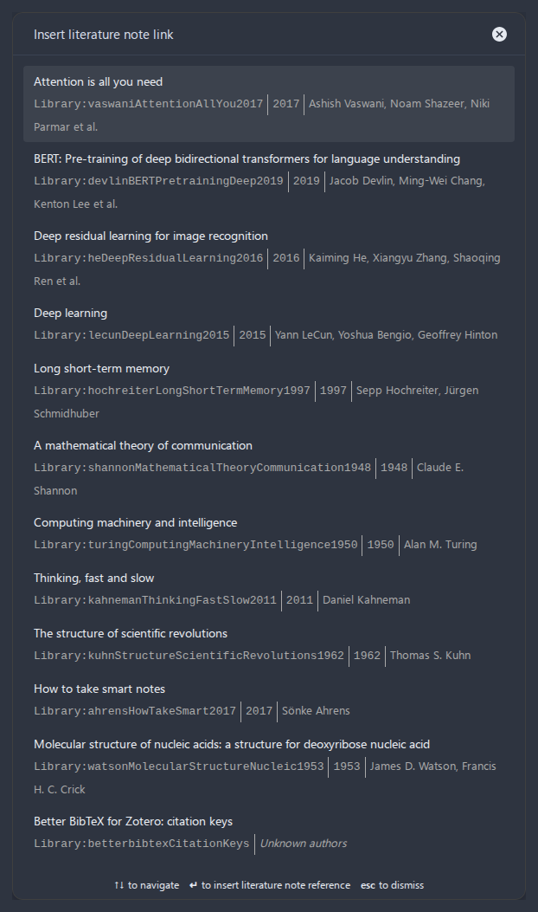
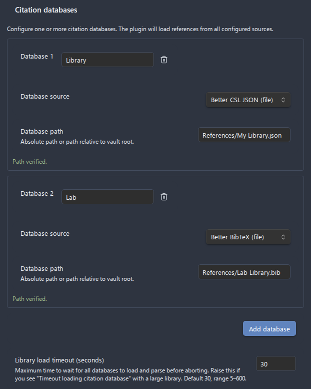

# Obsidian Citation Extended

This plugin for [Obsidian](https://obsidian.md) integrates your academic reference manager with the Obsidian editing experience.



The plugin supports reading bibliographies in [BibTeX / BibLaTeX `.bib` format][4], [CSL-JSON format][1], [Hayagriva YAML][5], directly from the [Readwise](https://readwise.io) API, and **live from a running Zotero**, either via the [Better BibTeX][2] pull-export endpoint or through **Zotero's own local API** (Zotero 7+, no extensions required).

## Quick Start

1. Install from Obsidian's Community Plugins browser
2. Export your bibliography from [Zotero + Better BibTeX][2], Mendeley, or Paperpile, or connect a running Zotero directly
3. Add the database in **Settings** > **Citation Extended**
4. Run **Citation Extended: Open literature note** from the Command Palette to search and open literature notes. No hotkeys are assigned by default, so bind one in **Settings** > **Hotkeys** if you use it often

For detailed setup instructions, see [Getting Started](docs/getting-started.md).

## Features

- **Open literature note**: create or open a note for any reference
- **Insert literature note link**: insert a wiki-link or markdown link
- **Insert literature note content**: insert rendered template content at cursor
- **Insert markdown citation**: insert [Pandoc-style citations][3] with presets (textcite, parencite)
- **Inline citation autocomplete**: type `@` or `[@` to get a suggestion popover backed by the same fuzzy search index
- **References sidebar**: a side panel listing every reference cited in the active note, with one-click navigation, Cmd/Ctrl-click to jump to a citation in the note, and "copy bibliography"
- **Zotero PDF annotation import**: both Zotero sources can bring structured highlights, comments, and annotation deep links into templates
- **Native Zotero connection**: use the built-in Local API on Zotero 7+ with native citekeys and optional group or collection scoping. Zotero 10+ adds incremental sync for whole personal and group libraries. See [Zotero (local API)](docs/data-sources.md#zotero-local-api-without-better-bibtex).
- **Non-destructive note updates**: re-sync literature notes with the library. The plugin owns only its `{{#syncBlock}}` callouts and template frontmatter keys, merges changes three-way (yours + the library's) against the last synced snapshot, and shows a diff review dialog on real conflicts. Your own content is never touched
- **Insert or replace with template output**: select outdated text in a note (such as PDF links from before a new attachment), extract the template part that produced it, edit it or load a saved profile, preview the result, and replace only the selection. With nothing selected, insert the output at the cursor
- **Readwise integration**: import highlights and documents from Readwise as citable entries
- **Refresh citation database**: manually reload all sources

See [Features](docs/features.md) for details.

## Templates

Customize your notes using [Handlebars](https://handlebarsjs.com/) templates with 25+ variables, 18+ helpers, and built-in citation style presets.

- [Template Variables](docs/templates/variables.md): all available variables
- [Template Helpers](docs/templates/helpers.md): comparison, string, date, author helpers
- [Template Examples](docs/templates/examples.md): recipes for YAML frontmatter, Zettelkasten, conditional content

## Multiple Databases

Load citations from multiple `.bib`, `.json`, or `.yml` files, the Readwise API and a running Zotero at the same time. Every search result shows the name of its database, and a citekey found in two databases is kept as two separate entries.



See [Data Sources](docs/data-sources.md) and [Configuration](docs/configuration.md) for details.

## Documentation

Full documentation is in the [docs/](docs/index.md) directory.

## Network Use

This plugin accesses the network only when **you** configure it to, and it never sends telemetry or analytics.

- **Readwise API (`readwise.io`)**: contacted **only** if you add a Readwise data source and supply your own API token, in order to fetch your highlights (v2) and documents (v3) as citable entries. If you set a sync interval, the plugin re-fetches from this endpoint on that schedule. Otherwise it fetches on demand. Your token is stored locally in plugin settings and sent only to Readwise for authentication.
- **Local Zotero (`127.0.0.1:23119`)**: contacted **only** if you add a database whose source is **Zotero (Better BibTeX)** or **Zotero (local API)**. Both can fetch PDF annotations when **Import PDF annotations** is enabled. The Better BibTeX source uses the pull-export and JSON-RPC endpoints. The native source uses Zotero's built-in local API. This is loopback traffic to Zotero on the same machine.
- **Documentation links (`github.com`)**: the settings screen links to the plugin's documentation. These open in your browser **when you click them**. The plugin makes no automatic requests to GitHub.

All bibliography parsing happens locally. Nothing leaves your vault unless you explicitly enable the Readwise integration above.

## File and Clipboard Access

The plugin reads files outside your vault and lists the notes inside it only for the features below, and it writes nothing outside the vault.

- **Library files outside the vault**: a database whose source is a file (Better CSL JSON, Better BibTeX or Hayagriva (YAML)) reads the path you enter, which may be absolute and outside the vault, through Node's file system on desktop. The plugin watches that one file and reloads the library when it changes.
- **Markdown notes in the vault**: to find the literature note of a citekey, the plugin lists the vault's Markdown files and matches them by path, by file name in any folder, and, when **Note identifier field** is set, by that frontmatter field. It reads no note content for this beyond Obsidian's metadata cache.
- **Opening attachments**: in the search of **Open literature note**, **Shift+Tab** hands the entry's PDF to your operating system as a `file://` path, and **Tab** opens the entry in Zotero through a `zotero://` link. Nothing is opened unless you press one of them.
- **Clipboard**: the plugin only writes to the clipboard, when you press **Copy bibliography** in the References view or **Copy all** in the template variable list. It never reads the clipboard.

## Development

```bash
npm run dev      # Watch mode
npm run build    # Production build
npm run lint     # ESLint
npm test         # Jest test suite
```

Before opening a pull request, run the CRAP gate. It runs the suite with coverage and fails when a function in `src/` scores over 8 on CRAP (complexity squared times the cube of its uncovered share, plus complexity) unless `crap-baseline.json` already records it at that score or higher. Files Jest leaves out of the coverage report, such as `src/worker.ts`, are not scored, and the gate names them in its summary. It needs Node 22.18 or later, which runs the TypeScript of `tools/crap-gate.ts` directly.

```bash
npm run crap-gate
```

On a green run, `npm run crap-gate -- --update-baseline` records every function that got better, so the baseline only falls. The complexity, parameter and length limits it shares with ESLint are checked by `npm run lint`, with existing debt recorded in `.eslint/suppressions.json`. Once a recorded violation is fixed, prune it:

```bash
npx eslint --suppressions-location .eslint/suppressions.json --prune-suppressions src
```

See [Architecture](docs/architecture.md) for the design of the plugin.

## License

MIT License.

## Support

If you find this plugin useful, consider [buying me a coffee](https://coff.ee/akhmelevskiy).

[1]: https://github.com/citation-style-language/schema#csl-json-schema
[2]: https://retorque.re/zotero-better-bibtex/
[3]: https://pandoc.org/MANUAL.html#extension-citations
[4]: http://www.bibtex.org/
[5]: https://github.com/typst/hayagriva
