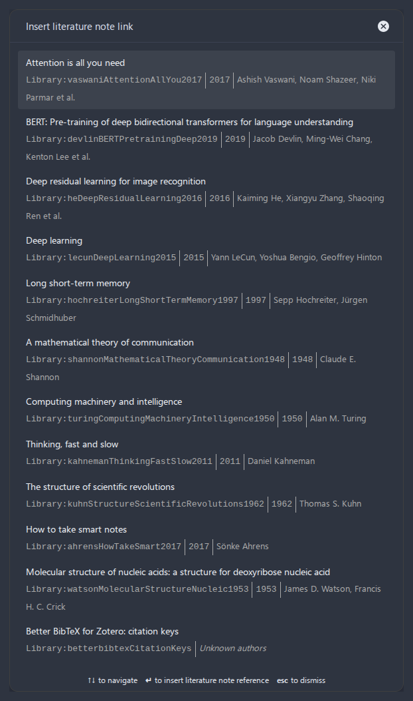

# Obsidian Citation Extended

This plugin for [Obsidian](https://obsidian.md) integrates your academic reference manager with the Obsidian editing experience.



The plugin supports reading bibliographies in [BibTeX / BibLaTeX `.bib` format][4], [CSL-JSON format][1], [Hayagriva YAML][5], directly from the [Readwise](https://readwise.io) API, and **live from a running Zotero** — either via the [Better BibTeX][2] pull-export endpoint or through **Zotero's own local API** (Zotero 7+, no extensions required).

## Quick Start

1. Install from Obsidian's Community Plugins browser
2. Export your bibliography from [Zotero + Better BibTeX][2], Mendeley, or Paperpile, or connect a running Zotero directly
3. Add the database in **Settings** > **Citation Extended**
4. Run **Citation Extended: Open literature note** from the Command Palette to search and open literature notes. No hotkeys are assigned by default, so bind one in **Settings** > **Hotkeys** if you use it often

For detailed setup instructions, see [Getting Started](docs/getting-started.md).

## Features

- **Open literature note** — create or open a note for any reference
- **Insert literature note link** — insert a wiki-link or markdown link
- **Insert literature note content** — insert rendered template content at cursor
- **Insert markdown citation** — insert [Pandoc-style citations][3] with presets (textcite, parencite)
- **Inline citation autocomplete** — type `@` or `[@` to get a suggestion popover backed by the same fuzzy search index
- **References sidebar** — a side panel listing every reference cited in the active note, with one-click navigation, Cmd/Ctrl-click to jump to a citation in the note, and "copy bibliography"
- **Zotero PDF annotation import** — pull native Zotero highlights into templates as structured data (text, comment, color, page, tags) with `zotero://` deep links that open the PDF at the exact annotation
- **Native Zotero connection** — read a running Zotero (7+) through its built-in local API: no Better BibTeX, no export files, native citation keys, group libraries and collection scoping
- **Non-destructive note updates** — re-sync literature notes with the library: the plugin owns only its `{{#syncBlock}}` callouts and template frontmatter keys, merges changes three-way (yours + the library's) against the last synced snapshot, and shows a diff review dialog on real conflicts. Your own content is never touched
- **Insert or replace with template output**: select outdated text in a note (such as PDF links from before a new attachment), extract the template part that produced it, edit it or load a saved profile, preview the result, and replace only the selection; with nothing selected, insert the output at the cursor
- **Readwise integration** — import highlights and documents from Readwise as citable entries
- **Refresh citation database** — manually reload all sources

See [Features](docs/features.md) for details.

## Templates

Customize your notes using [Handlebars](https://handlebarsjs.com/) templates with 25+ variables, 18+ helpers, and built-in citation style presets.

- [Template Variables](docs/templates/variables.md) — all available variables
- [Template Helpers](docs/templates/helpers.md) — comparison, string, date, author helpers
- [Template Examples](docs/templates/examples.md) — recipes for YAML frontmatter, Zettelkasten, conditional content

## Multiple Databases

Load citations from multiple `.bib`, `.json`, or `.yml` files, the Readwise API and a running Zotero at the same time. Every search result shows the name of its database, and a citekey found in two databases is kept as two separate entries.


See [Data Sources](docs/data-sources.md) and [Configuration](docs/configuration.md) for details.

## Documentation

Full documentation is in the [docs/](docs/index.md) directory.

## Network Use

This plugin accesses the network only when **you** configure it to, and it never sends telemetry or analytics.

- **Readwise API (`readwise.io`)** — contacted **only** if you add a Readwise data source and supply your own API token, in order to fetch your highlights (v2) and documents (v3) as citable entries. If you set a sync interval, the plugin re-fetches from this endpoint on that schedule; otherwise it fetches on demand. Your token is stored locally in plugin settings and sent only to Readwise for authentication.
- **Local Zotero (`127.0.0.1:23119`)** — contacted **only** if you add a database whose source is **Zotero (Better BibTeX)** or **Zotero (local API)**. The first pulls the Better BibTeX export and, when "Import PDF annotations" is on, your PDF annotations via the Better BibTeX JSON-RPC endpoint. The second reads Zotero's built-in local API. This is loopback-only traffic to Zotero running on the same machine; nothing crosses the network.
- **Documentation links (`github.com`)** — the settings screen links to the plugin's documentation. These open in your browser **when you click them**; the plugin makes no automatic requests to GitHub.

All bibliography parsing happens locally. Nothing leaves your vault unless you explicitly enable the Readwise integration above.

## Development

```bash
npm run dev      # Watch mode
npm run build    # Production build
npm run lint     # ESLint
npm test         # Jest test suite
```

See [Architecture](docs/architecture.md) for the design of the plugin.

## License

MIT License.

## Support

If you find this plugin useful, consider [buying me a coffee](https://coff.ee/akhmelevskiy).

[1]: https://github.com/citation-style-language/schema#csl-json-schema
[2]: https://retorque.re/zotero-better-bibtex/
[3]: https://pandoc.org/MANUAL.html#extension-citations
[4]: http://www.bibtex.org/
[5]: https://github.com/typst/hayagriva
