# Configuration

All settings are accessible in **Settings** > **Citation Extended**.

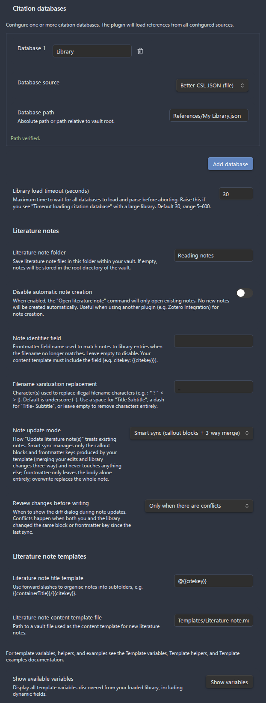
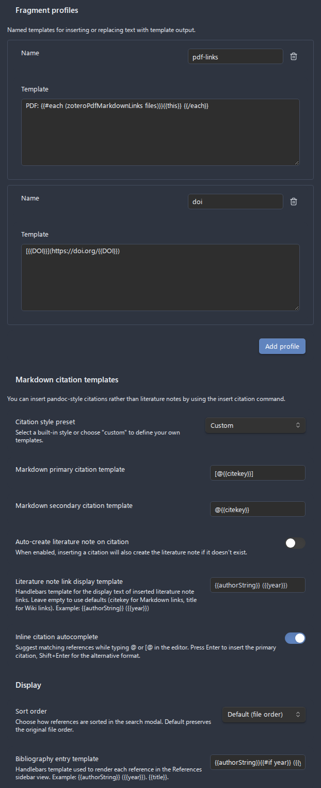

---

## Citation Databases

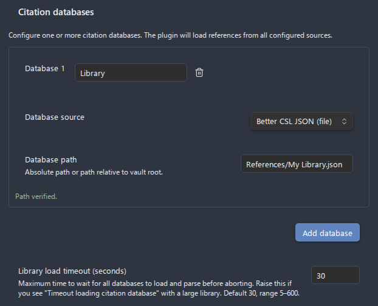

This section controls where the plugin reads your bibliography data from.

| Setting | Description | Default |
|---------|-------------|---------|
| Database name | Friendly label shown before the citekey of every search result, such as `Library:smith2023`. You can rename a database at any time without breaking existing literature notes or wiki-links | `Database 1` |
| Database source | Where the references come from: one of the six sources listed in [Database Sources](#database-sources) below. Changing it re-renders the card with the fields of the new source. Switching to a file source or to Zotero (local API) also reloads the library and shows a confirmation notice | `Better CSL JSON (file)` |
| Database path | Shown for the three file sources. Absolute or vault-relative path to the exported bibliography file. After the path is validated, the library reloads automatically (with a short debounce delay) | (empty) |

- Up to 20 databases supported
- Each database receives a stable internal identifier on creation. This identifier is invisible to the user but ensures that renaming a database does not break composite citekeys or literature note links
- Every search result shows the name of its database before the citekey, so when the same citekey appears in several databases, each copy is listed separately and the prefix tells them apart
- Switching a database to another source and back keeps the path, URL or token you entered for each source
- Path validation runs automatically and shows "Path verified" or "File not found"
- Removing a database immediately triggers a library reload so the search index reflects the change

### Database Sources

The **Database source** dropdown lists every way to load references:

| Option | Reads | Fields on the card |
|--------|-------|--------------------|
| Better CSL JSON (file) | A `.json` CSL-JSON export | Database path |
| Better BibTeX (file) | A `.bib` BibTeX or BibLaTeX export | Database path |
| Hayagriva (YAML file) | A `.yml` Hayagriva bibliography used by Typst | Database path |
| Readwise | Highlights and documents from the Readwise API | See [Readwise Integration](#readwise-integration) |
| Zotero (Better BibTeX) | A running Zotero through the Better BibTeX pull export | See [Live Zotero (Better BibTeX) settings](#live-zotero-better-bibtex-settings) |
| Zotero (local API) | A running Zotero 7 or later through its built-in local API | See [Zotero (local API) settings](#zotero-local-api-settings) |

### Database Formats

**Better CSL JSON** (`.json`) — The Citation Style Language JSON format. This is a standardized, lightweight format that most reference managers can export. It loads quickly and is the recommended choice for most users.

- **Best for:** Zotero (via "Export Library" → Better CSL JSON), Mendeley, Paperpile
- **Advantages:** Fast parsing, standard format, smaller file size
- **Limitations:** May not include all custom fields (e.g. PDF file paths, Zotero notes)

**Better BibTeX** (`.bib`) — A LaTeX bibliography format that carries richer metadata than CSL-JSON, including PDF file paths, keywords, abstract, and annotation notes. Parsing is slower because the BibTeX grammar is more complex.

- **Best for:** Zotero with [Better BibTeX](https://retorque.re/zotero-better-bibtex/) plugin, LaTeX users
- **Advantages:** Richer metadata (PDF paths, keywords, notes), seamless LaTeX integration, full Cyrillic support via `\cyrchar` commands
- **Limitations:** Slower to parse on large libraries (5000+ entries), larger file size

**Zotero (local API)** — Not a file format: reads a running Zotero (7 or later) directly through the local HTTP API built into Zotero itself. No Better BibTeX and no export file needed; enable one checkbox in Zotero's Advanced settings. Citation keys come from Zotero's native Citation Key field (with Extra-field and generated fallbacks).

- **Best for:** users without Better BibTeX, group libraries, maximum resilience to Zotero updates
- **Advantages:** zero extensions, live data, collection/group scoping, native citekeys
- **Limitations:** requires Zotero 7+, no Zotero notes import, custom BBT citekey formulas only via pinned/native keys — see [Data Sources: Zotero (local API)](data-sources.md#zotero-local-api--no-better-bibtex-required)

### Setting Up Multiple Databases

To use more than one bibliography source (e.g. personal library + shared team library):

1. Open **Settings** > **Citation Extended** > **Citation databases**
2. Your first database is already configured. Enter its name, source and path
3. Click **Add database** to add a second entry
4. Give each database a unique name, because this label appears before the citekey of every search result
5. If both databases contain the same citekey, both entries stay in the library under separate composite citekeys and you pick one in the search modal (see [Data Sources: Duplicate Handling](data-sources.md#duplicate-handling))


### Library load timeout

| Setting | Description | Default |
|---------|-------------|---------|
| **Library load timeout (seconds)** | Maximum time to wait for all databases to load and parse before aborting. Raise this if you see "Timeout loading citation database" with a large or heavily LaTeX-escaped library. Range `5`–`600` | `30` |

A load that exceeds this timeout is **not** retried automatically — the parse may still be running in the background, and a retry would queue another parse behind it. If you hit the timeout, raise the value and re-run **Refresh citation database** (or reopen the vault). Out-of-range values typed in the field are clamped to the valid range.

### Live Zotero (Better BibTeX) settings

Shown on a database card whose **Database source** is **Zotero (Better BibTeX)**. These require Zotero running with the Better BibTeX plugin.

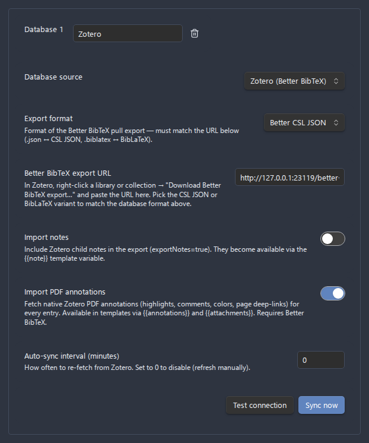

| Setting | Description | Default |
|---------|-------------|---------|
| **Export format** | Format of the Better BibTeX pull export, **Better CSL JSON** or **Better BibTeX**. It must match the export URL (`.json` for CSL JSON, `.biblatex` for BibLaTeX) and selects the parser. Changing it reloads the library | `Better CSL JSON` |
| **Better BibTeX export URL** | The URL Zotero gives for **Download Better BibTeX export…** on a library or collection | (empty) |
| **Import notes** | Include Zotero child notes in the export (`exportNotes=true`). They become available via the `{{note}}` template variable | `false` |
| **Import PDF annotations**       | Fetch native Zotero PDF annotations (highlights, comments, colors, page deep-links) for every entry via the Better BibTeX JSON-RPC API. Exposed in templates as `{{annotations}}`, `{{attachments}}`, and `{{annotationCount}}`. Requires Better BibTeX. Toggling recreates the source | `false` |
| **Auto-sync interval (minutes)** | How often to re-fetch from Zotero. Set to `0` to disable (refresh manually). Maximum `10080` (1 week), and larger values are clamped. The interval is shared with the Zotero (local API) source | `0` |
| **Test connection** | Asks Zotero for its version and reports the Zotero and Better BibTeX versions under the fields, or the error | |
| **Sync now** | Fetches the export from Zotero and reloads the library | |

### Zotero (local API) settings

Shown on a database card whose **Database source** is **Zotero (local API)**. These require Zotero 7 or later with **Settings** > **Advanced** > **Allow other applications on this computer to communicate with Zotero** enabled, as the hint at the top of the card says.

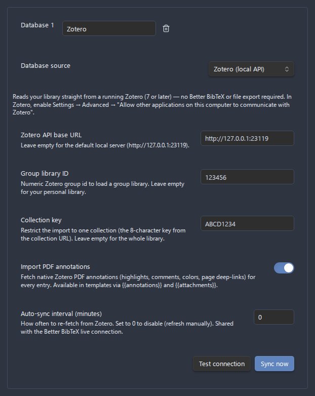

| Setting | Description | Default |
|---------|-------------|---------|
| **Zotero API base URL** | Address of the Zotero local server. Leave empty for `http://127.0.0.1:23119` | (empty) |
| **Group library ID** | Numeric Zotero group id to load a group library instead of your personal library | (empty) |
| **Collection key** | The 8-character key of one collection to restrict the import to | (empty) |
| **Import PDF annotations** | Fetch native Zotero PDF annotations for every entry. Exposed in templates as `{{annotations}}` and `{{attachments}}` | `false` |
| **Auto-sync interval (minutes)** | How often to re-fetch from Zotero. Set to `0` to disable. Shared with the Zotero (Better BibTeX) source | `0` |
| **Test connection** | Reports how many items Zotero makes visible with the current scope, or the error | |
| **Sync now** | Fetches the library from Zotero and reloads it | |

See [Data Sources: Zotero (local API)](data-sources.md#zotero-local-api--no-better-bibtex-required) for how citation keys are resolved.

---

## Readwise Integration

Connect the plugin to your Readwise account to import highlights and documents as citable entries. Readwise is configured as a regular database in the **Citation databases** section -- there is no separate settings panel.

### Adding a Readwise Database

1. Open **Settings** > **Citation Extended** > **Citation databases**
2. Click **Add database**
3. In the new database card, change the **Database source** dropdown to **Readwise**
4. The card now shows Readwise-specific fields instead of a file path

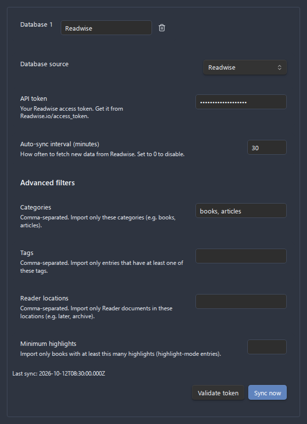

### Readwise Database Card Settings

| Setting / Button | Description |
|------------------|-------------|
| **Database name** | Friendly label for this database (default: `Database N`). You can rename it to `Readwise` or any name you prefer |
| **Database source** | Must be set to **Readwise** |
| **API token** | Your Readwise access token (password field). Get it from [readwise.io/access_token](https://readwise.io/access_token). Stored in plugin settings |
| **Auto-sync interval (minutes)** | How often the plugin automatically fetches new data from Readwise, in minutes. Set to `0` to disable automatic sync. Default: `30`. Maximum: `10080` (1 week) — larger values are clamped to avoid timer overflow |
| **Advanced filters** | Per-database import filters sub-section (see below). Optional |
| **Validate token** | Tests the API token against Readwise. Shows "Token is valid" or "Token is invalid" |
| **Sync now** | Fetches data from both Readwise APIs and reloads the library. On success, updates the "Last sync" timestamp; on failure it reports the error and does **not** update the timestamp |

### Import Filters (Advanced filters)

Each Readwise database can optionally restrict which entries are imported. Filters are applied after fetching and are stored per-database. Leave a field empty to disable that filter.

| Filter                 | Description                                                                                                          |
| ---------------------- | -------------------------------------------------------------------------------------------------------------------- |
| **Categories**         | Comma-separated. Import only entries in these categories (e.g. `books, articles`). Matched case-insensitively        |
| **Tags**               | Comma-separated. Import only entries that have at least one of these tags. Tags are user-defined and case-sensitive  |
| **Reader locations**   | Comma-separated. Import only Reader documents in these locations (e.g. `later, archive`). Matched case-insensitively |
| **Minimum highlights** | Import only books with at least this many highlights (applies to highlight-mode entries only)                        |

### How It Works

When a Readwise database is configured with a valid API token, clicking **Sync now** fetches data from both Readwise APIs in parallel:

- **v2 Export API** -- books with nested highlights (Kindle, Instapaper, etc.). Entries use citekeys like `rw-12345`
- **v3 Reader API** -- documents, articles, and PDFs saved in Readwise Reader. Entries use citekeys like `rd-abc123`

Both sets of entries are merged into a single database. There is no mode selector -- the plugin always loads from both APIs automatically.

Readwise entries support all standard plugin features: citation insertion, literature note creation, templates, and batch operations. See the [Readwise Integration use case](use-cases/readwise-integration.md) for a complete walkthrough.

### Offline Cache

After each successful sync, the plugin saves Readwise data to a local cache file at `.obsidian/plugins/citation-extended/readwise-cache-<id>.json` — one file per Readwise database (keyed by its stable id) so multiple Readwise databases never overwrite each other's cache. If the Readwise API is unavailable on the next load (e.g., no network connection), the plugin falls back to the cached data automatically. A warning notice appears when cached data is used instead of a fresh API response.

### Security Note

Your Readwise API token is stored **unencrypted** in the plugin's `data.json` (`.obsidian/plugins/citation-extended/data.json`). Obsidian does not provide a secret store for plugins. Treat the vault accordingly: avoid committing it to a public git repository, and be mindful when syncing the vault through third-party cloud services. Revoke and regenerate the token at [readwise.io/access_token](https://readwise.io/access_token) if it is ever exposed.

The cache file is managed automatically -- you do not need to create or edit it. It is overwritten only after a fully successful sync where every Readwise API responds; a partial outage (one API unavailable) leaves the previous cache intact rather than replacing it with an incomplete snapshot.

---

## Hotkeys

The plugin does **not** assign default hotkeys to its commands. You choose the bindings that fit your workflow. To configure:

1. Open **Settings** > **Hotkeys**
2. Search for `Citation Extended`
3. Click the `+` button next to any command to assign a key combination

**Recommended bindings** (adjust to taste):

| Command                                     | Suggested hotkey | Rationale                                                                        |
| ------------------------------------------- | ---------------- | -------------------------------------------------------------------------------- |
| Open literature note                        | `Ctrl+Shift+O`   | Mnemonic: **O**pen note                                                          |
| Insert Markdown citation                    | `Ctrl+Shift+E`   | Quick citation insertion while writing                                           |
| Insert literature note link                 | `Ctrl+Shift+L`   | Mnemonic: **L**ink                                                               |
| Open literature note for citation at cursor | `Ctrl+Shift+G`   | No modal — jumps directly to the note for the citation under cursor              |
| Insert subsequent citation                  | —                | Appends `; @key2` to an existing `[@key1]` at cursor                             |
| Insert multiple citations                   | —                | Multi-select modal: add references one by one, insert combined `[@...]` on close |
| Insert literature note content in the current pane | —         | Used less frequently, assign if needed                                           |
| Refresh citation database                   | —                | Rarely needed (auto-reload handles most cases)                                   |
| Insert or replace with template output      | —                | Also available from the editor context menu on a selection                       |
| Update all literature notes                 | —                | Re-syncs every literature note with the library                                  |
| Update literature note for current file     | —                | Re-syncs only the note open in the active pane                                   |
| Show references for current note            | —                | Also available from the ribbon icon                                              |

---

## Literature Notes

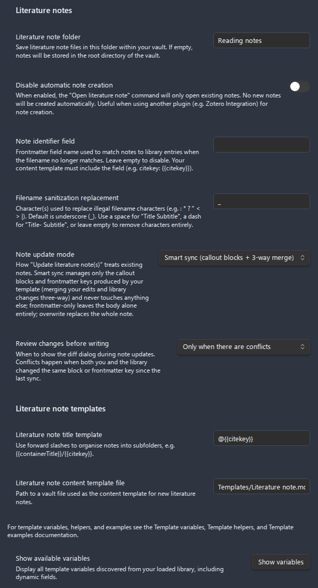

This section controls how literature notes are created, named, and where they are stored.

| Setting                               | Description                                                                                 | Default        |
| ------------------------------------- | ------------------------------------------------------------------------------------------- | -------------- |
| Literature note folder                | Folder inside the vault where new notes are created                                         | `Reading notes` |
| Disable automatic note creation       | When enabled, only opens existing notes — never creates new ones                            | `false`         |
| Note identifier field                 | Frontmatter field name used to find renamed notes (see [details below](#note-identifier-field)) | (empty)         |
| Filename sanitization replacement     | Character(s) used to replace illegal filename characters (`: * ? " < > \|`)                 | `_`             |
| Note update mode                      | How the update commands treat existing notes (see [details below](#note-update-mode))       | `Smart sync (callout blocks + 3-way merge)` |
| Review changes before writing         | When the diff review dialog appears (see [details below](#review-changes-before-writing))   | `Only when there are conflicts` |
| Literature note title template        | Handlebars template for the note filename (without `.md` extension)                         | `@{{citekey}}`  |
| Literature note content template file | Path to a vault file used as the note body template                                         | (empty)         |

### Literature note folder

The folder path is relative to the vault root. If the folder doesn't exist, it will be created when the first note is saved. Examples:

- `Reading notes` — notes saved to `<vault>/Reading notes/@smith2023.md`
- `References/Literature` — nested folder structure
- (empty) — notes saved directly in vault root

### Disable automatic note creation

When **off** (default): selecting a reference in the search modal creates a new note if one doesn't exist yet. When **on**: the command only opens existing notes and shows an error if no note exists for the selected reference. Useful when you create notes via another plugin (e.g. Zotero Integration) and only want to open them through this plugin.

### Note identifier field

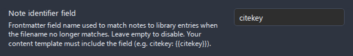

When you rename a literature note, the plugin can no longer find it by filename and may create a duplicate. The **Note identifier field** setting solves this by telling the plugin which frontmatter field to check as a last-resort lookup.

**How to set up:**

1. Add the identifier field to your content template's frontmatter:
   ```yaml
   ---
   citekey: {{citekey}}
   title: {{title}}
   ---
   ```
2. Set **Note identifier field** to the name of that field (e.g. `citekey`)
3. Now you can freely rename notes — the plugin will still find them

The field name is configurable, so you can use any identifier that your template provides:

| Field name   | Template frontmatter        | Use case                              |
| ------------ | --------------------------- | ------------------------------------- |
| `citekey`    | `citekey: {{citekey}}`      | Default — works with all source types |
| `zoteroId`   | `zoteroId: {{zoteroId}}`    | Zotero item key                       |
| `DOI`        | `DOI: {{DOI}}`              | Digital Object Identifier             |

When the field is empty (default), this lookup is disabled and the plugin uses filename-based matching only.

> **Note:** This only works for notes that have the configured field in their frontmatter. Existing notes created before adding the field need it added manually, or you can use **Update all literature notes** to re-render them from an updated template.

### Filename sanitization replacement

When generating filenames for literature notes, characters that are not allowed in filenames (`: * ? " < > |`) are replaced with this string. The default is underscore (`_`), so a title like "Title: Subtitle" becomes "Title_ Subtitle".

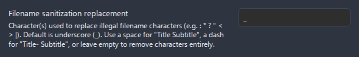

| Replacement | Input              | Output             |
| ----------- | ------------------ | ------------------ |
| `_`         | `Title: Subtitle`  | `Title_ Subtitle`  |
| ` ` (space) | `Title: Subtitle`  | `Title  Subtitle`  |
| `-`         | `Title: Subtitle`  | `Title- Subtitle`  |
| (empty)     | `Title: Subtitle`  | `Title Subtitle`   |

This setting also applies when slashes in data values are replaced to prevent unintended subdirectories, and when batch updates generate filenames via the citation service.

### Note update mode

Controls how **Update all literature notes** and **Update literature note for current file** treat existing notes.

| Mode | Behaviour |
|------|-----------|
| **Smart sync (callout blocks + 3-way merge)** (default) | Only content the plugin owns is managed: frontmatter keys rendered by the template and `{{#syncBlock}}` callouts (marked by native `^zc-…` block IDs). Each is merged three-way against the last synced snapshot, so library changes and your edits combine automatically; real conflicts open the review dialog. Everything else in the note is never touched. |
| **Update frontmatter only** | Frontmatter keys are merged the same way; the body is never touched. |
| **Overwrite notes completely** | The whole note is replaced by the freshly rendered template. |

### Review changes before writing

When the diff review dialog appears during note updates:

| Value | Behaviour |
|-------|-----------|
| **Only when there are conflicts** (default) | Clean merges are written automatically; the dialog opens only when you and the library changed the same thing. |
| **Before every change** | Every pending write shows the diff first. |
| **Never (conflicted notes are skipped)** | Clean merges are written. Conflicted notes are skipped and reported. |

See [Updating Literature Notes](use-cases/updating-literature-notes.md) for the full model, including how deletions and pre-existing notes are handled.

### Literature note title template

A Handlebars template that produces the filename (without `.md`). The default `@{{citekey}}` creates files like `@smith2023.md`.

**Common patterns:**

| Template | Result | Use case |
|----------|--------|----------|
| `@{{citekey}}` | `@smith2023.md` | Default, easy to identify |
| `{{citekey}}` | `smith2023.md` | Without @ prefix |
| `{{lastname}} {{year}} — {{titleShort}}` | `Smith 2023 — Attention.md` | Human-readable |
| `{{type}}/{{citekey}}` | `article-journal/@smith2023.md` | Subfolder by type |

> **Slashes in data values:** If a variable value contains a forward slash (e.g. a title like "Author A / Author B"), the slash is automatically replaced with an underscore before rendering. This prevents data values from creating unintended subdirectories. Only literal `/` characters in the template itself (e.g. `{{type}}/{{citekey}}`) act as directory separators.

### Literature note content template file

Path to a Markdown file in your vault that serves as the template body. This is the recommended approach — it lets you edit the template as a normal note with full syntax highlighting. If the path is empty, an empty note body is created.

**How to set up:**

1. Create a new note in your vault (e.g. `Templates/literature-note.md`)
2. Write your template using Handlebars syntax (see [Template Examples](templates/examples.md))
3. Enter the path `Templates/literature-note.md` in this setting

> **Migration note:** Earlier versions of the plugin used an inline text field for the content template. If you upgrade from an older version, the plugin automatically migrates your inline template to a vault file and sets the path for you.

### Show available variables

Click the **Show variables** button to open a modal listing all template variables discovered from your loaded library, including dynamic fields from your bibliography. You can copy the full list as a Markdown table.

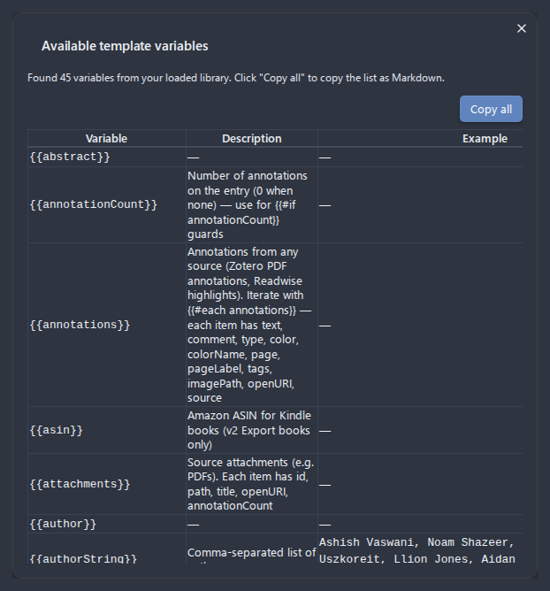

### Subfolder Support

Use forward slashes in the title template to organize notes into subfolders:

```handlebars
{{type}}/{{citekey}}
```

This creates notes like `Reading notes/article-journal/@smith2023.md`. Missing folders are created automatically.

The plugin searches recursively in subfolders when opening notes, so manually moved notes are still found. If a note is moved completely outside the literature note folder (e.g. into a project-specific folder), the plugin performs a vault-wide search as a last resort before creating a duplicate. That last resort applies only when exactly one note in the vault carries the expected name — when several do, the plugin creates the note rather than risk writing to an unrelated one.

See [Template Examples: Subfolder Organization](templates/examples.md#subfolder-organization) for more patterns.

### Fragment profiles

Named templates for the **Insert or replace with template output** command. Each profile has a **Name** and a **Template** (Handlebars, rendered with the entry of the note the command runs in). **Add profile** creates one named `New profile` (then `New profile 2`, …), the trash icon removes one, and a name another profile already uses is refused with a message under the field.

Profiles are also created, renamed and saved from the **Profile** field of the dialog. A profile only fills the dialog: changing or deleting it does not change notes where it was applied.

- **Default:** no profiles


See [Replacing a Selection with Template Output](use-cases/replace-selection-with-template.md).

---

## Markdown Citations

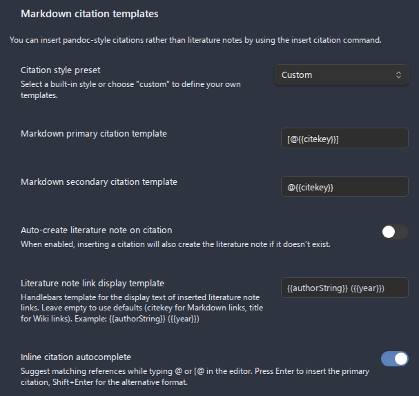

This section controls what text is inserted when you use the **Insert Markdown citation** command or the inline autocomplete.

| Setting | Description | Default |
|---------|-------------|---------|
| Citation style preset | Built-in style or custom (see table below) | `custom` |
| Markdown primary citation template | Template for the main citation format | `[@{{citekey}}]` |
| Markdown secondary citation template | Template for the alternative format (activated by **Shift+Enter** in the search modal) | `@{{citekey}}` |
| Auto-create literature note on citation | Create the literature note file when inserting a citation, if it doesn't exist yet | `false` |
| Literature note link display template | Custom Handlebars template for the display text of inserted literature note links. Leave empty to use defaults (citekey for Markdown, title for Wiki) | (empty) |
| Inline citation autocomplete | Suggest matching references while typing `@`/`[@` in the editor | `On` |

### Citation style preset

Select a built-in style to auto-fill both template fields, or choose `custom` to define your own. When a preset is active, the template fields are disabled and say "Controlled by the active citation style preset." Switch to `custom` to edit them.

| Preset | Primary | Alternative | Use case |
|--------|---------|-------------|----------|
| textcite | `{{authorString}} ({{year}})` | `[@{{citekey}}]` | In-text narrative citation: "Smith (2023) showed that..." |
| parencite | `({{authorString}}, {{year}})` | `[@{{citekey}}]` | Parenthetical citation: "...as shown (Smith, 2023)" |
| citekey | `[@{{citekey}}]` | `@{{citekey}}` | Pandoc-compatible: compile Markdown to PDF/DOCX with citeproc |
| custom | User-defined | User-defined | Full control over both templates |

### Primary vs secondary citation

- **Primary**: inserted when you press **Enter** in the search modal
- **Secondary**: inserted when you press **Shift+Enter** — use it for an alternative format (e.g. switch between `[@smith2023]` and `Smith (2023)`)

### Auto-create literature note on citation

When **on**: inserting a citation also creates the literature note file if it doesn't exist. When **off** (default): only the citation text is inserted, no note file is created. Enable this if you want every cited reference to have a corresponding note.

### Literature note link display template

Controls the display text shown in links inserted by the **Insert literature note link** command. Leave empty to use the defaults:

- **Markdown links** (`[display](path)`): display text = citekey (e.g. `[smith2023](notes/smith2023.md)`)
- **Wiki links** (`[[path]]`): display text = note title

When a template is set, it is rendered with all template variables (just like citation templates) and used as the display text for both link formats. For wiki links, the alias syntax `[[path|display]]` is used.

**Common patterns:**

| Template | Result (Markdown) | Result (Wiki) |
|----------|-------------------|---------------|
| (empty — default) | `[smith2023](path)` | `[[path]]` |
| `{{authorString}} ({{year}})` | `[Smith, Jones (2023)](path)` | `[[path\|Smith, Jones (2023)]]` |
| `{{titleShort}}` | `[Attention](path)` | `[[path\|Attention]]` |
| `@{{citekey}}` | `[@smith2023](path)` | `[[path\|@smith2023]]` |

### Inline citation autocomplete

When enabled, typing `@` or `[@` in the editor opens a suggestion popover backed by the same fuzzy search index as the search modal. Press **Enter** to insert the primary citation format, **Shift+Enter** for the alternative format. The typed trigger (including a leading `[`) is replaced by the rendered citation. Disable this setting if you prefer to insert citations only through the search modal. See [Features: Inline Citation Autocomplete](features.md#inline-citation-autocomplete).

---

## Display

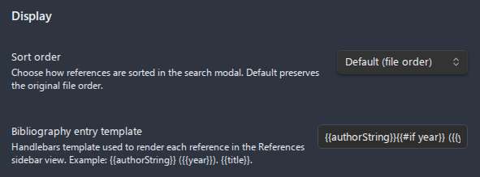

| Setting | Description | Default |
|---------|-------------|---------|
| Sort order | How references are sorted in the search modal and the inline autocomplete | `Default (file order)` |
| Bibliography entry template | Handlebars template used to render each reference in the References sidebar | `{{authorString}}{{#if year}} ({{year}}){{/if}}. {{title}}.` |

### Bibliography entry template

Controls how each reference is displayed in the **References** sidebar view (see [Features: References Sidebar](features.md#references-sidebar)). It is a standard Handlebars template with access to all [template variables](templates/variables.md). For example, the default `{{authorString}}{{#if year}} ({{year}}){{/if}}. {{title}}.` renders as `Jane Smith (2023). A Study.`, and leaves out the parentheses for an entry without a year. Leave empty to fall back to the default.

### Sort order options

| Option | Behavior |
|--------|----------|
| Default (file order) | Entries appear in the order they are stored in the bibliography file |
| By year (newest first) | Most recent publications first — useful for finding recent references quickly |
| By year (oldest first) | Oldest publications first — useful for chronological review |
| By author (A to Z) | Alphabetical by first author's last name |

Entries missing the sort field (e.g. no year) are placed at the end of the list.
