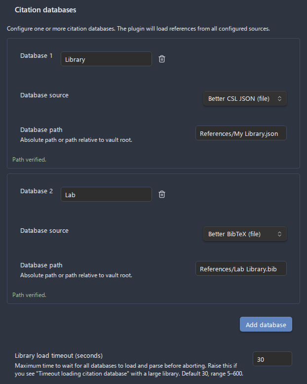
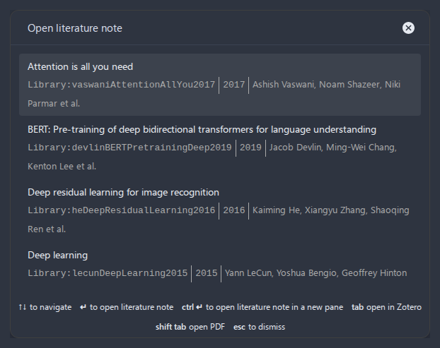

# Getting Started

## Installation

Install from Obsidian's Community Plugins browser:

1. Open **Settings** > **Community plugins** > **Browse**
2. Search for **Citation Extended**
3. Click **Install**, then **Enable**

## Configuring a Citation Database

The plugin reads bibliography data from files exported by your reference manager, or live from Zotero and Readwise. Every database is configured in **Settings** > **Citation Extended** > **Citation databases**, where its **Database source** dropdown picks the source.

### Zotero (recommended)

1. Install [Better BibTeX](https://retorque.re/zotero-better-bibtex/) in Zotero
2. Select a collection in Zotero's left sidebar
3. **File** > **Export library...** > choose **Better BibLaTeX** or **Better CSL JSON**
4. Check **Keep updated** for automatic re-export
5. Save the file somewhere accessible from your vault

### Mendeley

1. Export your library as BibTeX (`.bib` file)
2. In plugin settings select the **Better BibTeX (file)** source (the label for BibLaTeX `.bib` files)

### Paperpile

1. Enable [automatic BibTeX sync](https://forum.paperpile.com/t/new-automatic-bibtex-sync-and-overleaf-integration-public-beta/5680/3)
2. Use Hazel or similar to copy the `.bib` file to your vault

### Typst / Hayagriva

If you use [Typst](https://typst.app) for typesetting, you can use your Hayagriva `.yml` bibliography file directly:

1. In plugin settings, select **Hayagriva (YAML file)** as the database source
2. Point to your `.yml` file

### Readwise

If you use [Readwise](https://readwise.io) to collect highlights, you can import them directly — no file export needed:

1. In plugin settings, click **Add database** and set the **Database source** to **Readwise**
2. Paste your API token (get it from [readwise.io/access_token](https://readwise.io/access_token))
3. Click **Validate token**, then **Sync now**

See [Readwise Integration](use-cases/readwise-integration.md) for a complete walkthrough.

### Zotero without an export file

A running Zotero can be read directly, without exporting a file. Select **Zotero (local API)** for Zotero 7 or later with no extension, or **Zotero (Better BibTeX)** to pull a Better BibTeX export URL. See [Zotero Integration](use-cases/zotero-integration.md) and [Data Sources](data-sources.md) for both.

### Adding the Database in Settings

1. Open **Settings** > **Citation Extended** > **Citation databases**
2. The first database card is already there. Click **Add database** for each further source
3. Enter a friendly name, select the **Database source**, and provide the file path
4. The status indicator will show "Path verified" when the file is found

## Creating Your First Literature Note

1. Open the Command Palette (`Ctrl+P`) and run **Citation Extended: Open literature note**, or press the hotkey you assigned to it
2. Search for a reference by title, author, or year
3. Select a reference — the plugin creates a note using your configured template
4. The note is saved in your configured literature note folder

## Quick Reference: All Commands

| Command | What it does |
|---------|-------------|
| Open literature note | Opens (or creates) a literature note for a selected reference |
| Insert literature note link | Inserts a `[[link]]` or `[link](path)` to a literature note |
| Insert literature note content in the current pane | Pastes rendered template content at cursor |
| Insert Markdown citation | Inserts `[@citekey]` or custom format at cursor |
| Insert subsequent citation | Appends to an existing citation: `[@a]` → `[@a; @b]` |
| Insert multiple citations | Multi-select mode: pick several, insert `[@a; @b; @c]` |
| Open literature note for citation at cursor | Jumps to the note for `[@citekey]` under cursor — no modal |
| Update all literature notes | Re-syncs every literature note with the library and the current content template |
| Update literature note for current file | Re-syncs only the literature note open in the active pane |
| Show references for current note | Opens the References sidebar listing every citation in the active note |
| Insert or replace with template output | Replaces the selected text of a note with fresh template output, or inserts it at the cursor |
| Refresh citation database | Reloads all configured bibliography files |

See [Features](features.md) for detailed descriptions and [Configuration: Hotkeys](configuration.md#hotkeys) for recommended key bindings.
