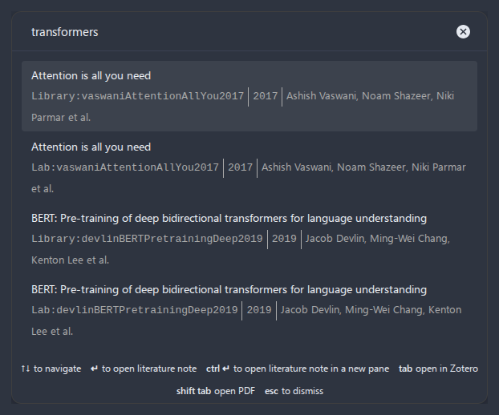

# Multiple Databases

## Problem

You maintain more than one bibliography: perhaps a personal research library and a shared team library, or separate databases for different projects, or a Zotero collection alongside a legacy Mendeley export. You want all of these sources available in a single search modal so you can cite and create notes from any of them without switching databases.

The plugin supports up to 20 databases loaded simultaneously. All entries are merged into one searchable library, and a citekey found in two databases is kept as two separate entries.

## Prerequisites

- Two or more bibliography sources: files exported from your reference manager(s), a running Zotero, or a Readwise account
- Each file in a supported format: CSL-JSON (`.json`), BibLaTeX (`.bib`), or Hayagriva (`.yml`)
- File paths accessible from your vault (absolute paths, or relative to the vault root)

## Step-by-Step Walkthrough

### Adding Multiple Databases

1. Open **Settings > Citation Extended > Citation databases**.

2. Your first database is already configured. Give it a descriptive name, for example `Personal Library`. Select the **Database source** (e.g., `Better BibTeX (file)`) and enter the file path:

   ```
   Name:   Personal Library
   Source: Better BibTeX (file)
   Path:   /home/user/Zotero/personal-library.bib
   ```

   The status indicator shows "Path verified" when the file is found.

3. Click **Add database** to add a second entry.

4. Configure the second database:

   ```
   Name:   Team Library
   Source: Better CSL JSON (file)
   Path:   /home/user/Dropbox/shared/team-references.json
   ```

5. Click **Add database** again if you have a third source:

   ```
   Name:   Conference Papers
   Source: Better BibTeX (file)
   Path:   /home/user/Zotero/conference-2024.bib
   ```

   The cards of two configured databases look like this:

   

6. Close settings. The plugin reloads all databases. The status bar shows the total count across all databases:

   ```
   Citations: 1847 entries
   ```

### Searching Across Databases

1. Open the Command Palette (`Ctrl+P`) and run any command that opens the search modal, or press the hotkey you assigned to one.

2. Search as usual. The modal searches across all loaded databases simultaneously. Results from different databases are interleaved based on search relevance.

3. Every result shows the name of its database before the citekey. When the same citekey exists in two databases, the reference is listed twice, once with each prefix:

   

4. Select the entry you want. The prefix tells you which database each result comes from.

### Understanding Composite Citekeys

When the same citekey exists in multiple databases, each duplicate receives a **composite citekey** that includes the database's stable internal identifier. For example, if `smith2023` exists in two databases, the composite citekeys look like:

```
smith2023@db-1711234567-a1b2
smith2023@db-1711234890-c3d4
```

This composite citekey is used for literature note filenames and wiki-links. Because it is based on the database's internal id (not the display name), **you can freely rename databases** in settings without breaking any existing notes or links.

> **Note:** Single-database setups and multi-database setups without overlapping citekeys are not affected. Citekeys remain unchanged (e.g. `smith2023`).

### Choosing Between Duplicates

No database takes precedence over another. Both copies of a duplicated citekey stay in the library under their own composite citekeys, and every command works on the copy you select in the search modal. Selecting `Personal Library:smith2023` creates or opens the note of the Personal Library entry, and selecting `Team Library:smith2023` creates or opens a separate note for the Team Library entry. The order of the databases in the settings does not matter.

## Expected Result

### Status Bar

After configuring three databases:

```
Citations: 1847 entries
```

### Search Modal with Duplicates

Searching for a citekey that exists in two databases lists one result per database, each with its own prefix:

```
Deep learning
Personal Library:lecun2015 | 2015 | Yann LeCun, Yoshua Bengio, Geoffrey Hinton

Deep learning
Team Library:lecun2015 | 2015 | Yann LeCun, Yoshua Bengio, Geoffrey Hinton
```

### Search Modal without Duplicates

A citekey found in one database is listed once, still with the name of its database:

```
Attention Is All You Need
Personal Library:vaswani2017 | 2017 | Ashish Vaswani, Noam Shazeer, Niki Parmar et al.
```

### Literature Note Created from a Duplicate

A literature note created for a duplicated citekey uses the entry you selected, and its `{{citekey}}` is the composite citekey of that entry. With the default title template `@{{citekey}}`, the note of the Personal Library copy is named `@lecun2015@db-1711234567-a1b2.md`, and a template line `citekey: {{citekey}}` renders as:

```markdown
---
title: "Deep learning"
authors: "LeCun, Bengio, Hinton"
year: 2015
citekey: lecun2015@db-1711234567-a1b2
---
```

A citekey found in only one database keeps its plain form, such as `citekey: vaswani2017`.

## Variations

### Personal Library + Shared Team Library

A common setup for research groups:

| Database | Format | Path | Purpose |
|----------|--------|------|---------|
| Personal Library | BibLaTeX | `/home/user/Zotero/my-library.bib` | Your personal references, exported from Zotero with Better BibTeX |
| Team Library | CSL-JSON | `/home/user/Dropbox/team/references.json` | Shared team references, synced via Dropbox |

A reference present in both libraries is listed twice in the search modal, so pick the `Personal Library` copy when you want your own annotations and notes.

### Mixing Formats

You can mix CSL-JSON, BibLaTeX, and Hayagriva databases freely:

| Database | Format | Use case |
|----------|--------|----------|
| Zotero export | BibLaTeX | Rich metadata with PDF paths and keywords |
| Mendeley export | CSL-JSON | Lightweight, fast loading |
| Typst bibliography | Hayagriva | YAML format for Typst documents |

All entries are normalized to a common internal format, so templates work the same regardless of the source format.

### Project-Specific Databases

For managing different research projects with separate bibliographies:

```
Database 1: Dissertation — /home/user/Zotero/dissertation.bib
Database 2: Side Project — /home/user/Zotero/side-project.bib
Database 3: Teaching — /home/user/Zotero/teaching.bib
```

All entries appear in one search, so you can cite across projects without reconfiguring.

### Vault File Sources

If your bibliography file is synced into your Obsidian vault (e.g., via Obsidian Sync or iCloud), you can use a vault-relative path:

```
Path: references/library.json
```

This is especially useful on mobile (iOS/Android) where absolute filesystem paths are not accessible.

## Tips

- **Naming matters.** Give each database a clear, descriptive name. These names appear as prefixes of every result in the search modal, and `Team Library:smith2023` is much more helpful than `Database 2:smith2023`.
- **Renaming is safe.** You can rename a database at any time in settings. The plugin uses a stable internal identifier for composite citekeys, so renaming does not break existing literature notes or wiki-links.
- **Keep the total count reasonable.** The plugin handles large libraries well (5000+ entries), but loading 20 large BibLaTeX files simultaneously will increase load time. CSL-JSON is significantly faster to parse than BibLaTeX.
- **The file watcher works per-database.** Each database file is watched independently. If you update `personal-library.bib`, only that database is reloaded, and the others stay cached.
- **Use "Refresh citation database" if something looks wrong.** If an entry from one database is not appearing, try running the refresh command from the Command Palette. This reloads all databases from disk.
- **Up to 20 databases are supported.** This is a practical limit to prevent excessive memory usage and load times.
