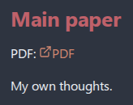
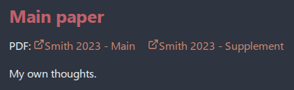
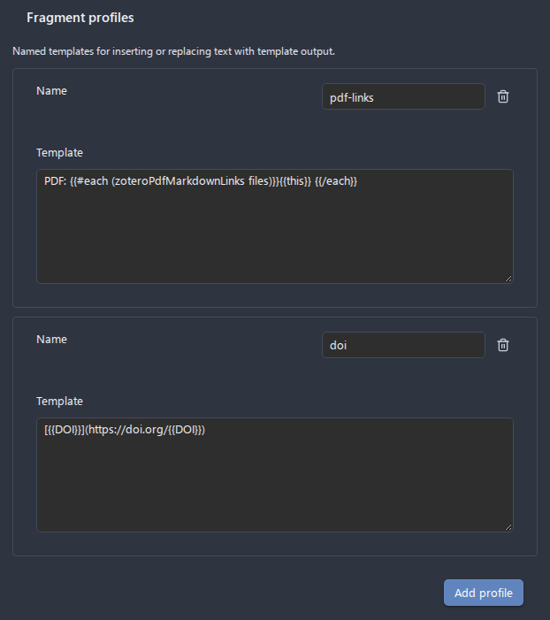

# Replacing a Selection with Template Output

## Problem

You created a literature note, and later added another PDF to the item in Zotero. The note still lists only the first PDF, because the line was rendered once, when the note was created. Deleting and recreating the note would lose everything you wrote in it, and changing your content template would not touch the notes that already exist.

The **Insert or replace with template output** command fixes exactly the part you select. You select the outdated text, the dialog finds the part of your content template that produced it, you adjust that template if you like, and the selection is replaced with the template output rendered from the current library data. The rest of the note is not touched.

This is a manual, one-time replacement. The plugin does not track the replaced text afterwards: when Zotero gets another PDF, select the text and run the command again. To keep parts of a note refreshed automatically, see [Updating Literature Notes](updating-literature-notes.md).

## Prerequisites

- At least one citation database configured and loaded
- A literature note open in the editor that the plugin can match to a library entry (see [Renaming Literature Notes](renaming-literature-notes.md) for how notes are matched)
- A content template file set in **Settings > Citation Extended > Literature note content template file**, if you want to extract the template part instead of typing it

## Step-by-Step Walkthrough

This example uses a content template with this line:

```handlebars
PDF: {{#each (zoteroPdfURIs files)}}[PDF]({{this}}) {{/each}}
```

The note was created when the item had one PDF:



1. **Select the outdated text.** Select the line `PDF: [PDF](zotero://open-pdf/library/items/EBAUJBLY)`. The selection can be part of a line, a whole line or several lines.

2. **Open the dialog.** Run **Citation Extended: Insert or replace with template output** from the Command Palette (`Ctrl+P`), or right-click the selection and choose **Insert or replace with template output**. The menu item appears whenever text is selected.

3. **Extract the template part.** In **Extract from**, keep the literature note template (or pick a profile template, when [template profiles](../configuration.md) are configured) and press **Extract**. The dialog finds the template lines that produced the selection, puts them into the **Template** field and says where they came from, for example `Extracted from citation-content-template.md, line 7.` Extract always returns whole template lines, so when you selected only part of a line, the selection in the note is extended to the whole line and the status adds `The selection now covers whole lines.` Without that, the text of the line you left unselected, such as `PDF: `, would appear twice.

4. **Adjust the template.** Edit the template if you want a different output. Here the line is changed to show the PDF file names, using [`zoteroPdfMarkdownLinks`](../templates/helpers.md#zoteropdfmarkdownlinks):

   ```handlebars
   PDF: {{#each (zoteroPdfMarkdownLinks files)}}{{this}} {{/each}}
   ```

   The **Result in the note** preview shows the change with the current library data: the selected text is struck out, and the template output that replaces it is shown below.

   

5. **Save the template as a profile (optional).** Type a name in **Profile**, for example `pdf-names`, and press **Save**. Next time, pick the profile in the same field instead of extracting and editing again.

6. **Apply.** Press **Apply**. The selection is replaced with exactly the template output, and nothing else in the note changes:

   

## Profiles

A profile is a name and a template, stored in the plugin settings. In the **Profile** field of the dialog:

- Typing filters the list of profiles. Pick one to load its template. **Save** then updates that profile.
- The last row of the list, **Create profile "…"**, starts a new profile under the typed name. **Save** stores it. Typing a different name after picking a profile does the same, so the picked profile is never overwritten by a variant saved under a new name.
- The pencil next to a profile selects it for renaming: change the name in the field and press **Save**. Only the pencil renames.
- **Save** stays disabled while the template is empty or another profile already uses the name.

Profiles can also be added, renamed, edited and removed in **Settings > Citation Extended > Fragment profiles**:



A profile only fills the dialog. Changing or deleting a profile later does not change any note where it was applied.

## Inserting Without a Selection

When the note has no text to replace, for example because the content template never had a PDF line, place the cursor where the links should go and run **Citation Extended: Insert or replace with template output** from the Command Palette. The dialog opens as **Insert template output**: **Extract** is unavailable, because there is nothing to extract from, and you load a profile or type the template, such as `{{#each (zoteroPdfMarkdownLinks files)}}{{this}} {{/each}}`. The preview lists only the lines that will be added, and **Apply** inserts them at the cursor.

The context menu item appears only on a selection, so use the Command Palette or a hotkey for inserting.

## Notes and Limits

- **Extract** matches every selected line with the most similar line of the rendered template. A rendered line counts only when it contains at least half of the words of the selected line, and list and callout markers are ignored. Text you wrote yourself or rewrote heavily is therefore not matched. When no selected line matches, the dialog says so, and you can pick a profile or type the template yourself.
- A template line inside a block (`{{#each}}`, `{{#if}}`, `{{#syncBlock}}`) is extracted together with its whole block.
- The template is rendered with the entry of the current note only.
- If the template fails to render, the error is shown in **Result in the note** and **Apply** stays disabled.
